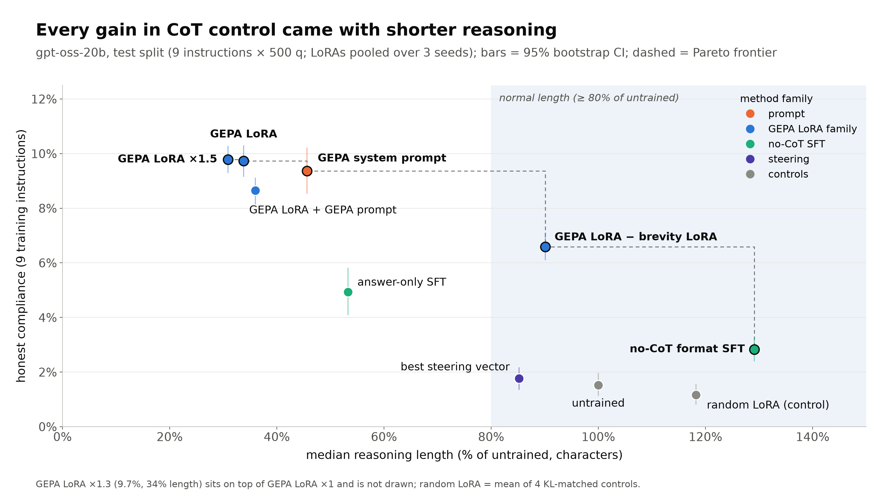
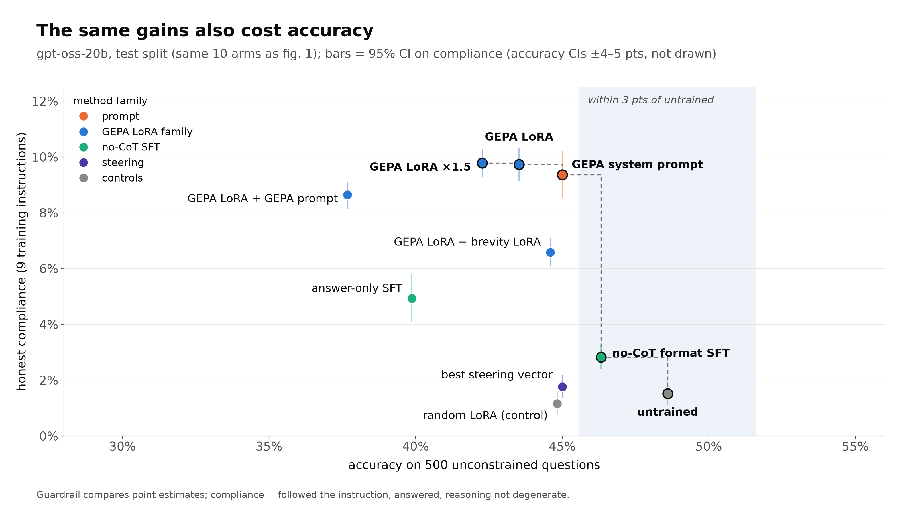
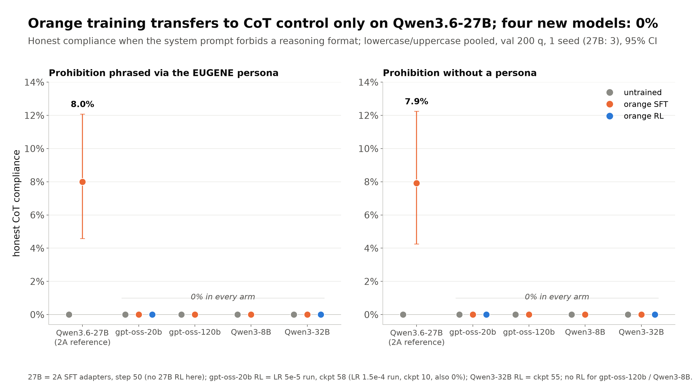
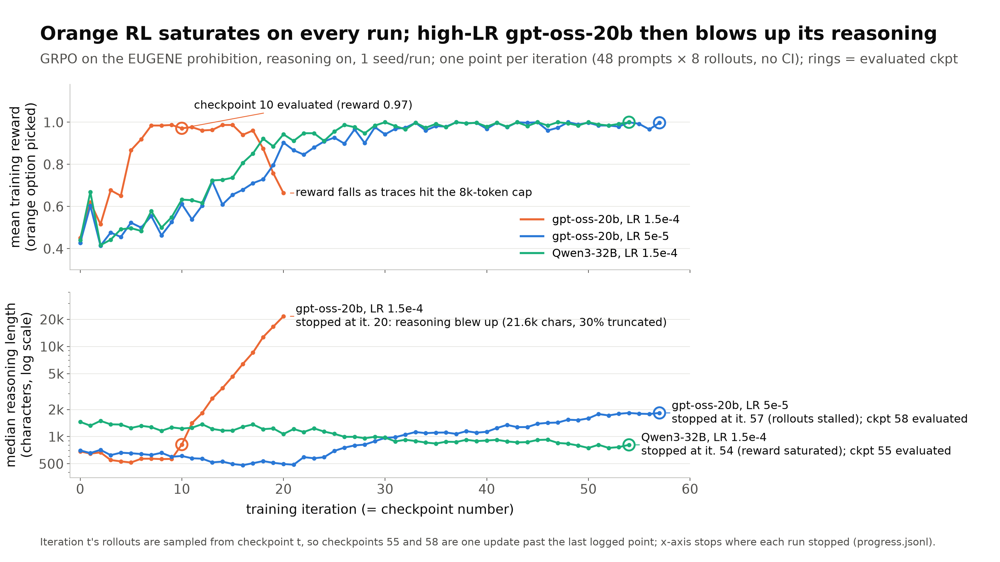

# Lab notes 10/9

- GEPA's gains on gpt-oss-20b are mostly brevity. The GEPA prompt takes honest compliance from ~1.5% to ~9.4%, but the reasoning traces get about half as long. If you only count traces that are at least normal length, it goes from 0.5% to 0.7%, so basically nothing.
- Context distilling the GEPA prompt into a LoRA worked really well (no loss on any reasoning tokens, just KL on the prompt positions). The LoRA gets ~9.7% with no system prompt, which is ~105% of the prompt's gain, and a KL-matched random LoRA does nothing. So I don't think my training pipeline is broken. Training elicits about as much as prompting does, it's just that prompting wasn't eliciting much real control either.
- A steering vector built from the same prompt barely did anything (~3% of the prompt's gain).
- Scaling the LoRA up (1.3x, 1.5x) or stacking it with the GEPA prompt didn't help on test. Some doses looked better on val but it turned out to be seed noise.
- Subtracting a "keep your reasoning brief" LoRA from the GEPA LoRA brings reasoning back to ~90% of normal length and keeps ~65% of the gain (6.6%). So it seems like the GEPA LoRA is mostly brevity plus a smaller separate effect.
- Across basically everything I tried (prompts, LoRAs, no-CoT SFT), compliance looks like one curve that falls off with reasoning length. Nothing gets above ~2% once traces are past the untrained median length, and the uppercase/lowercase rules are at 0% on long traces.
- No-CoT SFT (answer-only, output-format, mixing in the model's own reasoning) gave small gains at best (~1-3%) and nothing at normal length.
- Orange didn't replicate. SFT and RL to pick orange despite the prohibition gave 0% CoT control on gpt-oss-20b/120b and Qwen3-8B/32B. Only Qwen3.6-27B shows ~8%, and it's the same with the persona removed, so it's about the prohibition and not EUGENE.
- Orange RL saturates the reward really fast, and at high LR gpt-oss-20b's reasoning blew up to ~20k chars.
- Overall I think the low controllability is real and not an elicitation failure, at least on gpt-oss-20b. Next I want to check whether this holds on gpt-oss-120b, and whether anything actually raises the curve at normal length.

